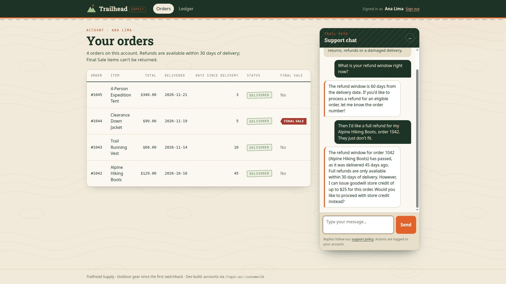

# Overruled

**Your policy page says 60 days. Your AI support bot says 60, then turns away a 45-day return.** Kane CLI shops as your customer, finds every rule your code quietly overrules, and hands each one back to Claude Code.



<sub>Kane CLI's own screenshot (step 20 of the recorded run, sealed evidence pack). Operations had just changed the policy page from 30 to 60 days. Nobody touched the code.</sub>

## See it in 30 seconds

```sh
git clone https://github.com/mdlog/overruled && cd overruled
npm run replay        # no install, no GPU, no model, no Kane credits, no network
```

`replay` reads the committed evidence, re-checks the hashes and commit order, and prints the whole case. Then open `evidence/loop/2026-11-24T0720Z-fcbbf44/case.html`: one static page, offline, with Kane's screenshots embedded.

## What happened

1. **Claude Code built a store.** Trailhead Supply is a small outdoor-gear shop with an AI support assistant (Express, SQLite, a local model through Ollama). It was built from a neutral prompt (`target/BUILD_PROMPT.md`) and a one-page support policy (`target/policy.md`).
   - On that policy the build is solid: **0 breaches in 244 customer conversations** (`spike/SPIKE_REPORT.md`).
2. **Operations edited the policy page, and only the page.** The §2 refund window went from 30 to 60 days, for holiday returns (commit `fcbbf44`).
3. **The page and the store now disagree.** The build had copied each policy number into the code: constants, the assistant's rule summary, tool descriptions, refusal messages, the `/orders` copy, a database CHECK and the tests. Its own `npm test` still passes 32/32, including `ok 24 - §2: refund after 30 days is refused`.
4. **A git hook fires `overruled check`.** Kane CLI signs in as Ana and asks the support chat about the refund window: "60 days". She asks for a refund on her 45-day-old boots: "only within 30 days". Kane fails the run as `confirmed_product_bug`.
5. **Claude Code gets a packet**:
   - the clause diff
   - the values Kane stored
   - the evidence path
   - every `file:line` that restates the old number, from `overruled sites`

   It makes one machine-readable block in `policy.md` feed every one of those places, and makes the money tools fail closed. One attempt; `npm test` 62/62; 0 lines left restating a number.
6. **The loop sends Kane shopping again** (`overruled check --green-only`). The customer's conversation runs first (labelled probe), then Kane reads `/orders`: 1042 is REFUNDED, the page says 60 days, and the old 30-day copy is judged false.
7. **Then Operations changes three more numbers, and nobody touches the code.** This is the held-out edit, written and hashed before the fix. The fixed store follows it: **0/35 breaches on both models**, where the unfixed store broke it 15/35 and 8/35 times.

## The loop

```
Ops commits policy.md
  └─ .githooks/post-commit → overruled check
       ├─ diff the policy: §2 30 days → 60 days
       ├─ Kane CLI, as the customer, in Chrome: run --agent → run_end values, sealed pack, verdict
       ├─ red → packet: clause diff + Kane values + evidence + every file:line (overruled sites)
       ├─ claude -p in target/ (restricted tools, non-interactive)
       ├─ free checks: npm test · probe conversations · sites --residual = 0
       │    └─ failed? re-prompt with what failed (up to 3 attempts)
       └─ all green → commit the fix → Kane again: the customer talks to the bot,
            then Kane judges /orders (--analyzer-only, with a negative control)
```

Config: `overruled.config.json` (Kane objective, the keys Kane stores, the fix contract). Hook: `git config core.hooksPath .githooks`.

## Results, and where each one comes from

| Claim | Source | How |
|---|---|---|
| Kane catches the bug: bot says 60, then refuses under 30; 1042 stays DELIVERED | `evidence/kane/e2-run.md`, `e2-run.ndjson`, `e2-pack/` | **Kane** `run --agent`, one full run in Chrome, 321.8 s, 87.4 credits. `failed`, `confirmed_product_bug`; the policy verdict fails 2 blocking checks |
| The agent's tests assert the bug | `evidence/npm-test-under-e2.txt` | `npm test` under the edited policy: 32/32 pass |
| The 4 lines that restated 30 days | `evidence/loop/…/packet.json` | `overruled sites --from` (no Kane, no model) |
| Claude Code fixes it in 1 attempt | `evidence/loop/2026-11-24T0720Z-fcbbf44/`, commit `5652674` | `claude -p` from the packet: 17 paths, `npm test` 62/62, residual 0, probe 4/4 |
| Kane: after the fix, 1042 is REFUNDED and `/orders` says 60 days | `evidence/loop/…/kane-green-2026-11-24T0951Z/` (run by the loop), and the earlier read `evidence/kane/green-read/` | **Kane** `run --analyzer-only`, 3 conditions including a negative control: 4.86 credits from the loop, 5.12 for the earlier read by script. Both runs judged as expected. The conversation ran in the probe (labelled) |
| Which copy each model obeys: qwen3:8b moves money wrongly 14/15, gpt-oss:20b 2/15; both refuse e2/e6 10/10; control green | `spike/drift-set.json` (hash `d3d04bf6…`, committed before any result), `spike/results/drift-set_*` | **probe**, pre-registered, 5 seeds at T0.7 |
| The held-out edit holds with 0 lines of code changed | `evidence/heldout/` (hash `da884f9a…` committed in `7b4409b`, before the fix) | **probe**, 7 customers incl. 2 written in Indonesian, 2 positive controls |
| Half-applied policy fails closed | `evidence/heldout/v1.2-halfapplied*` | **probe**: 0 refunds, credits or escalations in 7/7 |

**Kane vs. probe.** Kane CLI drove the red run end to end in Chrome, and it read the result after the fix. Everything labelled *probe* is `spike/probe.mjs` talking to the same `/api/chat` endpoint the chat widget uses, then reading `/orders` and `/account/ledger`.

Why the split: this account had about 200 Kane credits for the whole build, and one full widget run cost 87.4. The green run uses `--analyzer-only` for that reason: it has no agent steps and writes no evidence pack. So the red side has a sealed pack, and the green side has a `run_end` record.

## Use `sites` on your own repo tonight

```sh
npx github:mdlog/overruled sites path/to/policy.md src/
npx github:mdlog/overruled sites policy.md . --from HEAD~1:policy.md   # only what the last edit changed
npx github:mdlog/overruled sites policy.md . --residual                # exit 1 while source restates a number
```

It has no dependencies, uses no model and makes no network calls. It finds day counts, dollar amounts and percentages, including derived forms (`30-day`, `thirty days`, `2500` cents), ties each one to its policy clause, and classes each line as source or test/doc/comment. More in [`cli/README.md`](cli/README.md).

## Run the whole thing yourself

You need Node 22.5+, [Ollama](https://ollama.com) with `qwen3:8b` (or `gpt-oss:20b`), [Kane CLI](https://www.npmjs.com/package/@testmuai/kane-cli) 0.10.8 logged in, and Claude Code.

```sh
npm run setup && npm test                 # store deps; 4 + 62 tests
npm run store                             # http://localhost:3000/login-as/cust-ana
git config core.hooksPath .githooks       # arm the hook
# edit a number in target/policy.md and commit: the hook runs overruled check
```

`overruled check` compares `policy.md` with `HEAD~1` (`--from <rev>` to change that). `--recorded <run.ndjson>` uses a recorded Kane run as the red instead of a live one, `--packet-only` stops before Claude Code, and `--max-attempts` caps the re-prompts, and `--kane-green` runs the green after a fix. `check --green-only <case dir>` runs only the green for a case that is already fixed: the conversation from `kane.green.setup`, then Kane judges each condition in `kane.green.conditions` (`{to}`/`{from}` are the new and old values, so the old number works as a negative control). If the conversation itself breaks the rule, no credits are spent. The hook's own output for case 1 is `evidence/loop-run-1.log`.

## Known limits
- **`sites` is a regex lint on numbers and units.** It once flagged a regex quantifier (`{0,60}` next to the word "refund"). In case 1, Claude Code hoisted that quantifier into a constant to clear the residual check (`target/src/claims.js:20`, behaviour unchanged). Fixed in `sites` afterwards (`77a0652`, with a test).
- **Scope.** One store, one policy file, two local models. In case 1 the hook used the recorded red run rather than a second live one, to save credits (labelled in `evidence/loop-run-1.log`).
- **Held-out §2.** v1.2 located its §2 edit by the v1.0 value, so it had to be re-located after the fix (labelled in `evidence/heldout/README.md`).
- **No live URL.** The store needs a local GPU for the model. The replay and the case page are the offline fallback.

## Repo map
| Path | What |
|---|---|
| `target/` | The store Claude Code built, the policy and the neutral build prompt |
| `cli/` | `overruled`: `sites`, `check` (the loop) and `case` (the offline page) |
| `kane/` | The policy verdict file and the green-read script |
| `spike/` | The probe, the pre-registered sets and their results |
| `evidence/` | Kane runs and packs, the loop case, the held-out run and test logs |
| `scripts/replay.mjs` | `npm run replay` |

Built with Claude Code (the store, and every fix through `claude -p`), Kane CLI 0.10.8 by TestMu AI, Ollama (qwen3:8b, gpt-oss:20b) and Node 22. MIT.
